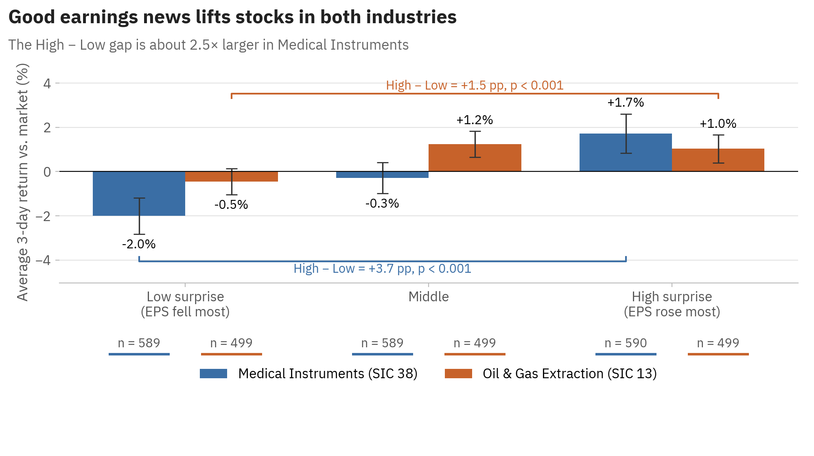
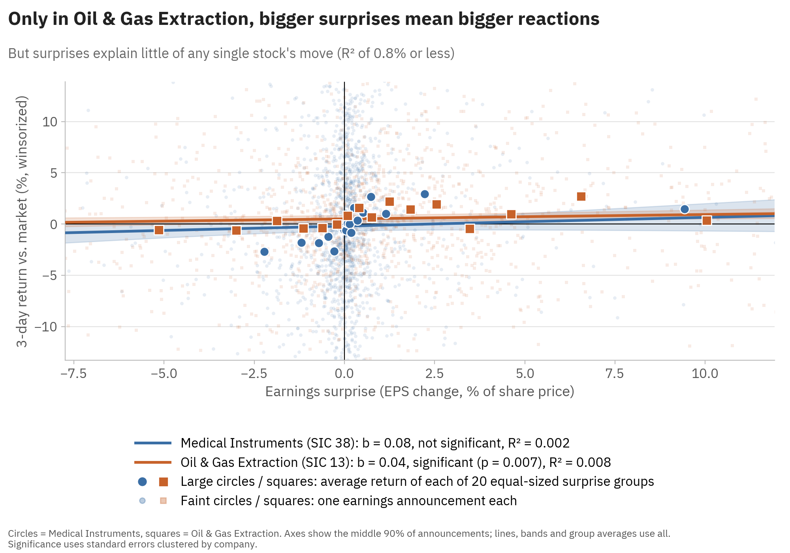
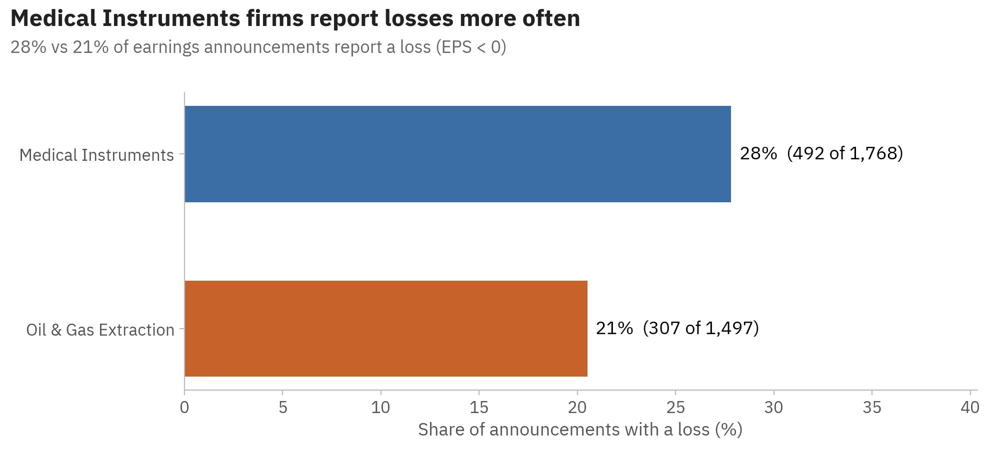
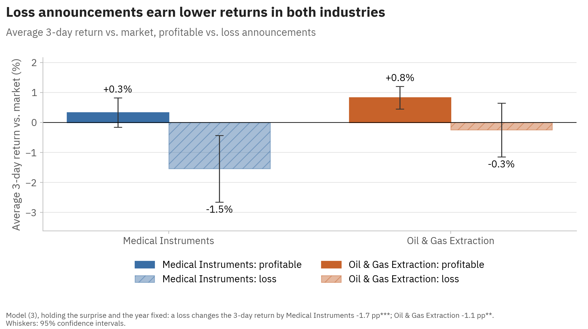
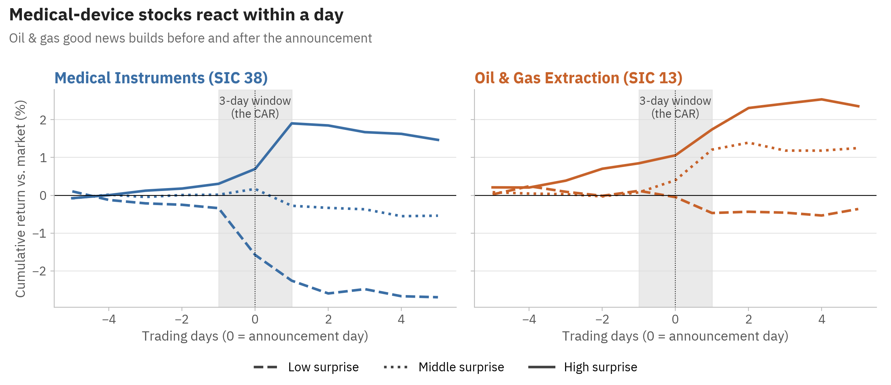
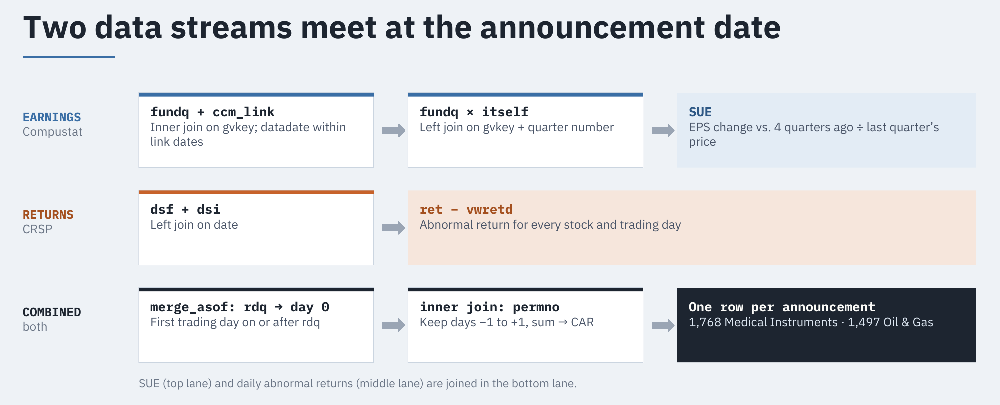

# When Stryker beats last year's earnings, how much does its stock react, and is it the same in oil and gas?

**Author:** Bea Macalalag · BAN 4550, Fall 2026 · Industry: 38, Medical Instruments (client: Stryker, SYK) · Comparison industry: 13, Oil & Gas Extraction

## The question
The client is Stryker, a medical-device company. It wants to know: Does its stock price rise when earnings surpass the same quarter last year, and is the stock market's reaction the same in medical devices as it is in the oil and gas industry?

## Main result
Good earnings news lifts stock prices in both industries, but the gap between good and bad news is more than twice as wide in Medical Instruments. In Medical Instruments, the average 3-day return above the market goes from −2.0% for the worst-news group to +1.7% for the best-news group, which is a gap of 3.7 points. In Oil & Gas, it only goes from −0.5% to +1.0%, which is a gap of 1.5 points.



## Is the difference real?
The t-test shows that the gap between good-news and bad-news stocks is real in both industries, at 3.73 points in Medical Instruments (t = 6.04, p < 0.0001) and 1.49 points in Oil & Gas (t = 3.39, p = 0.0007). However, the regression shows that bigger surprises only bring bigger reactions in Oil & Gas (b = 0.0429, p = 0.0007, R² = 0.0076), and not in Medical Instruments (b = 0.0848, p = 0.0885, R² = 0.0016). When I added year and loss controls, b stayed about the same, and in both industries earnings explained less than 1% of the stock's move.



## Why the industries differ
I proposed that the share of losses explains the difference, because losses are less persistent than profits, so investors may read them differently. Figure 3a shows that Medical Instruments reports losses more often (28% vs. 21% of announcements), and Figure 3b shows that a loss lowers the 3-day reaction by about 1.7 points in Medical Instruments and 1.1 points in Oil & Gas. However, my reason is only partially supported, because losses did not change how strongly prices respond to the size of the surprise (`sue × loss` p = 0.4259 and 0.8049).




## Advice for the client
Figure 4 shows that medical-device stocks react to earnings news on the announcement day and the day after, so the earnings release and call are Stryker's best chance to explain its results. One limitation is that SUE compares each quarter with the same quarter last year instead of with analyst forecasts, and earnings explain less than 1% of the stock's move. For next steps, I would ask whether beating analyst forecasts predicts Stryker's reaction better than beating last year (predictive), and whether Stryker should give forward guidance with its earnings to soften the reaction (prescriptive).



## Data
The data come from Compustat (`comp.fundq`), CRSP (`crsp.dsf`, `crsp.dsi`) and the CRSP/Compustat link file, all accessed through WRDS. The data are not included in this repository because of the WRDS license, but anyone with WRDS access can rebuild the results by running the notebook with the link file in the same folder. The sample covers earnings announcements from 2021 to 2024, and I only kept those with complete data, a stock price of at least $5 and no extreme surprises, which left me with 1,768 Medical Instruments and 1,497 Oil & Gas announcements.

## How the tables fit together
First, I linked Compustat quarters to CRSP stock IDs on `gvkey`, and only kept a link if it was valid on that quarter's date (`linkdt ≤ datadate ≤ linkenddt`). Then, I matched each quarter to its own history on `gvkey` and quarter number to get the EPS from four quarters earlier and last quarter's price, which I needed for SUE. On the CRSP side, I used `merge_asof` to set day 0 as the first trading day on or after `rdq`, and then joined on `permno` and trading-day number to pull days −1 to +1 of stock and market returns for CAR.



## How I checked the results
To check my results, I rebuilt Stryker's fiscal 2023 Q4 announcement (January 30, 2024) by hand in Excel, and I expected to get the same SUE and CAR as the notebook using the raw EPS, price and daily returns. Both matched exactly (SUE = 0.005599, CAR = 0.085107). This told me that the lag, price scaling and 3-day window in the code were correct, so I kept the same method for both industries.

## Changes since Project 2
| What was wrong | How I fixed it | How the results changed |
| My three SUE groups were not formed by a clean division into thirds, because I formed them with pd.qcut on the raw SUE values. However, many announcements share the same SUE, often exactly at 0, so these values were forced into the same group. | I ranked the announcements by SUE with rank(method='first') in order from smallest to largest. Each announcement then had its own row, even if some shared the same values. The three divisions were made with the ranked rows. | Only one announcement changed grouping, from middle to high. The counts went from 589/590/589 to 589/589/590. Averages remained unchanged, and the low-surprise group was still the worst-performing. |
| | | |

Write "None" if there was nothing to fix.

## Where the code came from
Code was provided by Professor Yoon, and any changes made with AI are documented below. 

| AI tool | Link (or PDF in docs/) | What I used it for |
| Claude | https://claude.ai/share/5c2bde64-c312-4916-ac10-6c8ed3283dd6 | For Project 2, I asked Claude to explain the entire objective and general methodology of the project to me in simple terms and with visual diagrams. I told Claude what changes I understood I needed to make to the code from Assignment 8, and I asked if I was missing anything. |
| Claude | https://claude.ai/share/5c2bde64-c312-4916-ac10-6c8ed3283dd6 | For Project 2, I asked it to duplicate Assignment 8 and make the least amount of changes possible to still meet the project parameters. I made my own copy of Assignment 8 and made the changes to each cell myself, following along with the output Claude gave me. I then also asked Claude to walk me through what is happening in each cell of the notebook.  |
| Claude | https://claude.ai/share/5c2bde64-c312-4916-ac10-6c8ed3283dd6 | For Project 2, I asked Claude to write code for some checks, then I also asked Claude to explain to me the importance of each check. I did my best to write explanations in my own words.  |
| Claude | https://claude.ai/share/5c2bde64-c312-4916-ac10-6c8ed3283dd6 | For Project 2, I also asked Claude to walk me through how to best explain and present the results. Claude wrote some extra code for the results, but I also asked for clear explanations of what is happening in each added cell. I also asked Claude to help me better understand how to interpret SUE and CAR.  |
| Claude | https://claude.ai/share/a5bd92a9-2ca4-4075-b204-bf7852b11496 | For Project 3, this was the singular Claude conversation I used. Essentially, I had Claude walk me through every step of the analysis. In particular, some major things I had it help me with were: revising my Project 2 code, understanding the statistical measures I needed to report, duplicating the given code for Project 3 and making the necessary changes, understanding what each cell in the Project 3 notebook did, interpreting every result from the analysis, and making the slides.  |
| | | |

Write "None" if you used no AI.

## Files
```
notebooks/ Macalalag_Bea_Project3-with-figures.ipynb (runs top to bottom on WRDS JupyterHub)
           Macalalag_Bea_Project2_revised.ipynb (revised Project 2 notebook)
figures/   figure1-CAR-by-SUE-group.png, figure2-SUE-CAR-regression.png,
           figure3a-loss-share.png, figure3b-loss-vs-profit.png,
           figure4-CAR-days-line.png, merge_map.png
docs/      Macalalag_Final Project Presentation.pdf (slides)
           Project 1-Report.pdf (Project 1 report)
README.md
```
